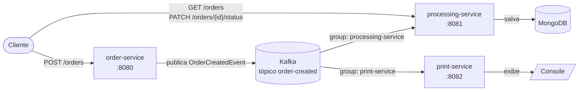
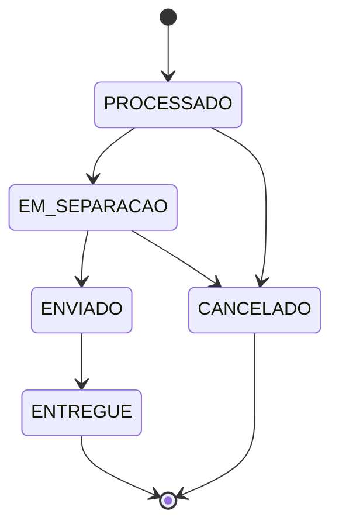

# Gerenciamento de Pedidos

Sistema de pedidos construído com **arquitetura de microsserviços**, comunicação assíncrona via **Apache Kafka**, persistência em **MongoDB** e monitoramento com **Spring Boot Actuator**.

Um serviço recebe os pedidos por uma API REST e publica um evento no Kafka. Outros dois serviços consomem esse mesmo evento de forma independente: um salva o pedido no banco e o outro exibe o pedido no console.

## Arquitetura



| Serviço | Responsabilidade | Porta |
|---|---|---|
| **order-service** | Recebe pedidos via REST, valida e publica o evento no Kafka | 8080 |
| **processing-service** | Consome os eventos, persiste no MongoDB e expõe consulta e atualização de status | 8081 |
| **print-service** | Consome os eventos e exibe cada pedido formatado no console | 8082 |

Como o `processing-service` e o `print-service` estão em **consumer groups diferentes**, cada um recebe **todas** as mensagens do tópico. Um serviço fora do ar não afeta os outros: as mensagens ficam no Kafka e são consumidas quando ele voltar.

## Tecnologias

- Java 21
- Spring Boot 4.2 (Web MVC, Validation, Kafka, Data MongoDB, Actuator)
- Apache Kafka 4.4 (modo KRaft, sem Zookeeper)
- MongoDB 8.0
- Docker e Docker Compose

## Como executar

### Opção 1: Docker Compose (recomendado)

Pré-requisito: Docker com o plugin Compose.

```bash
docker compose up -d --build
```

Isso sobe o Kafka, o MongoDB e os três microsserviços. Os serviços só iniciam depois que o Kafka e o MongoDB estão saudáveis. O primeiro build leva alguns minutos, porque o Maven baixa as dependências dentro do container.

```bash
docker compose ps                     # status dos containers
docker compose logs -f print-service  # acompanhar os pedidos impressos
docker compose down                   # parar tudo
docker compose down -v                # parar e apagar os dados
```

| Infraestrutura | Acesso pelo host | Credenciais |
|---|---|---|
| Kafka | `localhost:9094` | — |
| MongoDB | `localhost:27018` | `admin` / `admin` |

### Opção 2: Executar localmente (IDE ou Maven)

Pré-requisitos: Java 21, um Kafka em `localhost:9092` e um MongoDB em `localhost:27017`.

Em cada pasta de serviço:

```bash
./mvnw spring-boot:run
```

Para usar a infraestrutura do Docker Compose com os serviços rodando localmente:

```bash
docker compose up -d kafka mongodb

SPRING_KAFKA_BOOTSTRAP_SERVERS=localhost:9094 ./mvnw spring-boot:run   # order-service e print-service

SPRING_KAFKA_BOOTSTRAP_SERVERS=localhost:9094 \
SPRING_MONGODB_PORT=27018 SPRING_MONGODB_USERNAME=admin SPRING_MONGODB_PASSWORD=admin \
./mvnw spring-boot:run                                                  # processing-service
```

## API

Os erros seguem o padrão **ProblemDetail** ([RFC 9457](https://www.rfc-editor.org/rfc/rfc9457)).

### Criar pedido: `POST /orders` (order-service, porta 8080)

```bash
curl -X POST localhost:8080/orders \
  -H 'Content-Type: application/json' \
  -d '{
        "id": 1001,
        "items": [
          { "produto": "Café especial 500g", "quantidade": 2, "valor_unitario": 39.90 },
          { "produto": "Filtro de papel",    "quantidade": 1, "valor_unitario": 8.50 }
        ]
      }'
```

Resposta **202 Accepted**, com o evento publicado:

```json
{
  "eventId": "e5e24e35-b43c-47c4-b7e8-3ce9c1b90d75",
  "eventType": "ORDER_CREATED",
  "timestamp": "2026-11-25T17:05:23.656Z",
  "payload": {
    "id": 1001,
    "items": [
      { "produto": "Café especial 500g", "quantidade": 2, "valor_unitario": 39.90, "total": 79.80 },
      { "produto": "Filtro de papel",    "quantidade": 1, "valor_unitario": 8.50,  "total": 8.50 }
    ]
  }
}
```

O status é 202 e não 201 porque o pedido foi **aceito e publicado**, mas ainda vai ser processado de forma assíncrona pelos consumidores.

| Situação | Status |
|---|---|
| Pedido publicado no Kafka | `202` |
| Campos inválidos (id ≤ 0, lista vazia, quantidade ou valor ≤ 0, produto em branco) | `400` |
| JSON malformado | `400` |
| Produto repetido no mesmo pedido | `422` |
| Kafka indisponível | `503` |

### Listar pedidos: `GET /orders` (processing-service, porta 8081)

```bash
curl "localhost:8081/orders"
curl "localhost:8081/orders?page=0&size=10&sort=valorTotal,desc"
```

A listagem é paginada (padrão: 20 por página, mais recentes primeiro):

```json
{
  "content": [
    {
      "id": 1001,
      "status": "PROCESSADO",
      "itens": [ { "produto": "Café especial 500g", "quantidade": 2, "valor_unitario": 39.90, "total": 79.80 } ],
      "valor_total": 88.30,
      "criado_em": "2026-11-25T17:05:23.656Z",
      "processado_em": "2026-11-25T17:05:23.701Z",
      "atualizado_em": "2026-11-25T17:05:23.701Z"
    }
  ],
  "page": { "size": 20, "number": 0, "totalElements": 1, "totalPages": 1 }
}
```

### Buscar pedido: `GET /orders/{id}` (processing-service)

```bash
curl localhost:8081/orders/1001
```

Retorna `200` com o pedido ou `404` se ele não existir.

### Atualizar status: `PATCH /orders/{id}/status` (processing-service)

```bash
curl -X PATCH localhost:8081/orders/1001/status \
  -H 'Content-Type: application/json' \
  -d '{ "status": "EM_SEPARACAO" }'
```

O pedido segue um ciclo de vida, e só são aceitas as transições abaixo:



| Situação | Status |
|---|---|
| Transição permitida | `200` com o pedido atualizado |
| Status ausente ou desconhecido | `400` |
| Pedido não encontrado | `404` |
| Transição não permitida (ex.: `ENTREGUE` → `CANCELADO`) | `409`, informando `status_atual` e `status_permitidos` |

### Saída do print-service

```
============================================================
 PEDIDO #1001
 Evento: e5e24e35-b43c-47c4-b7e8-3ce9c1b90d75 (ORDER_CREATED)
 Criado em: 25/11/2026 14:05:23
============================================================
 Produto                        Qtd    Unitário       Total
 Café especial 500g               2       39,90       79,80
 Filtro de papel                  1        8,50        8,50
------------------------------------------------------------
 TOTAL DO PEDIDO (2 itens)                            88,30
============================================================
```

## Monitoramento (Actuator)

Os três serviços expõem:

| Endpoint | Conteúdo |
|---|---|
| `/actuator/health` | Saúde do serviço (no processing-service, inclui a conexão com o MongoDB) |
| `/actuator/info` | Nome e descrição do serviço |
| `/actuator/metrics` | Lista de métricas; detalhe em `/actuator/metrics/{nome}` |

```bash
curl localhost:8080/actuator/health
curl localhost:8081/actuator/health
curl localhost:8082/actuator/metrics/jvm.memory.used
```

## Tratamento de erros

### order-service

| Exceção | Quando ocorre | HTTP |
|---|---|---|
| `InvalidOrderException` | Regra de negócio violada (pedido sem itens, produto repetido) | 422 |
| `OrderPublishException` | Falha ou timeout ao publicar no Kafka | 503 |

O producer usa `acks=all` e idempotência habilitada, e falha em até 5 segundos (`max.block.ms`) se o broker estiver fora, em vez de deixar a requisição presa.

### processing-service

| Exceção | Quando ocorre | Comportamento |
|---|---|---|
| `InvalidOrderEventException` | Evento sem id, sem itens ou com item incompleto | Descartado sem nova tentativa: a mensagem continuaria inválida |
| `OrderPersistenceException` | Falha ao gravar no MongoDB | 3 novas tentativas, com 2s de intervalo |
| `OrderNotFoundException` | Consulta de pedido inexistente | HTTP 404 |
| `InvalidStatusTransitionException` | Mudança de status não permitida | HTTP 409 |

Mensagens com JSON inválido são tratadas pelo `ErrorHandlingDeserializer` e não travam o consumidor. O processamento também é **idempotente**: um evento já processado (mesmo `eventId`) é ignorado se o Kafka entregá-lo de novo.

## Estrutura do projeto

```
gerenciamento-pedidos/
├── docker-compose.yml
├── order-service/
│   └── src/main/java/.../order_service/
│       ├── controller/   OrderController: camada HTTP
│       ├── service/      OrderService: caso de uso "criar pedido"
│       ├── publisher/    OrderEventPublisher (interface) + KafkaOrderEventPublisher
│       ├── model/        Order e Item, com as regras de negócio
│       ├── dto/          OrderRequest, ItemRequest
│       ├── event/        OrderCreatedEvent: contrato da mensagem
│       ├── exception/    exceções customizadas + GlobalExceptionHandler
│       └── config/       criação do tópico
├── processing-service/
│   └── src/main/java/.../processing_service/
│       ├── listener/     OrderCreatedListener: consumidor Kafka
│       ├── controller/   OrderController: GET e PATCH
│       ├── service/      OrderService: processamento, consulta e status
│       ├── repository/   OrderRepository (Spring Data MongoDB)
│       ├── document/     OrderDocument, ItemDocument, OrderStatus
│       ├── dto/          OrderResponse, ItemResponse, UpdateStatusRequest
│       ├── event/        OrderCreatedEvent
│       ├── exception/    exceções customizadas + GlobalExceptionHandler
│       └── config/       retentativas do consumidor
└── print-service/
    └── src/main/java/.../print_service/
        ├── listener/     OrderCreatedListener: consumidor Kafka
        ├── service/      OrderPrinter: formata e exibe o pedido
        └── event/        OrderCreatedEvent
```

## Decisões de projeto

- **Cada serviço é dono dos seus dados.** Só o processing-service acessa o MongoDB, por isso a consulta e a atualização de status ficam nele. O order-service não tem banco: a fonte da verdade do pedido é o evento.
- **SOLID no order-service.** O controller só lida com HTTP. O `OrderService` depende da interface `OrderEventPublisher`, e não do Kafka, então a mensageria pode ser trocada ou simulada em testes sem alterar a regra de negócio.
- **Chave da mensagem = id do pedido.** Eventos do mesmo pedido vão sempre para a mesma partição, o que garante a ordem.
- **Contrato do evento duplicado em cada serviço**, em vez de uma biblioteca compartilhada, para manter os serviços independentes. Os consumidores ignoram campos desconhecidos, então o producer pode evoluir o evento sem quebrá-los.
- **Valores monetários em `BigDecimal`**, gravados como `Decimal128` no MongoDB, para não ter erros de arredondamento.
